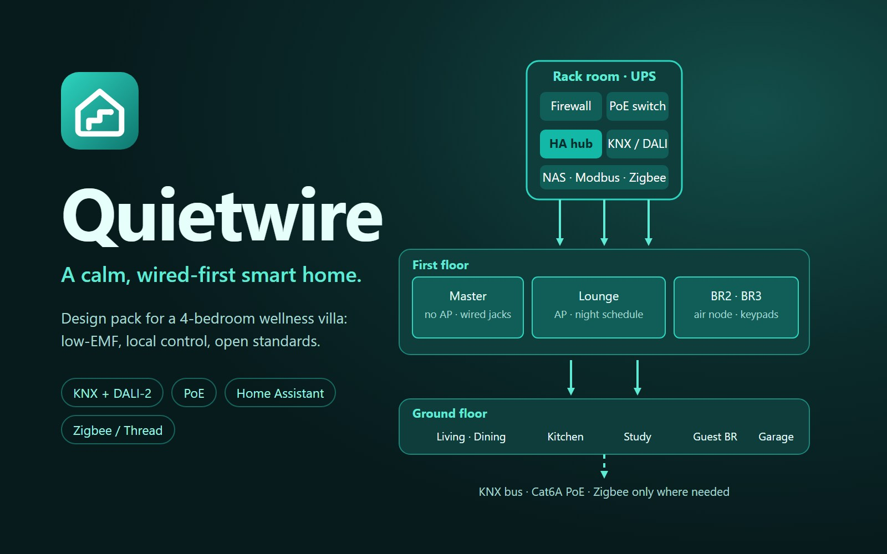

<b><a href="https://alok-kul5.github.io/quietwire-villa/">Live site</a></b>

<h1 align="center">Quietwire</h1>

<b>A calm, wired-first smart home.</b> A low-EMF design pack for a 4-bedroom wellness villa: KNX + Home Assistant, from device schedule and budget to commissioning and handover.

The pack covers a sample **4-bedroom wellness villa** (G+1, about 3,400 sq ft). It is written the way a Smart Home Project Manager hands work to architects, MEP consultants and integrators: decisions, reasons, schedules, budget, checklists and handover documents.

**Approach:** wellness first, wired-first and low-EMF, local control that works without the cloud, open standards (KNX, DALI-2, Modbus, Ethernet/PoE, Zigbee/Thread/Matter) with Home Assistant as the local integration hub.

> This is a design exercise on an assumed building, not a certified construction document. All prices are rough estimates. "Low-EMF" means reducing unnecessary always-on radio sources near where people sleep. It is not a health claim.

## At a glance

| | |
|---|---|
| Control backbone | KNX TP + DALI-2 DT8 for tunable-white lighting, Home Assistant as local hub |
| Network | Cat6A home-run to a rack room, PoE+ for APs, cameras, sensors, 6 VLANs |
| Wireless | Only where needed: Zigbee leak sensors, Thread/Matter lock. No AP in bedrooms, bedroom-covering Wi-Fi scheduled off at night |
| Subsystems | Circadian lighting, climate + ERV on CO2/PM2.5/VOC, water TDS + leak shut-off, energy monitoring, security, network |
| Scale | 44 tunable-white zones, 23 keypads, 21 presence sensors, 6 air nodes, 8 leak sensors, 6 cameras, 4 APs |
| Budget estimate | About INR 27 to 53 lakh (about USD 31k to 60k) including 10% contingency |
| Timeline | About 16 months, aligned to construction stages |

## Contents

| # | Document | What it answers |
|---|---|---|
| 01 | [Overview and principles](docs/01-overview-and-principles.md) | Assumed floor plan, design principles, system layers |
| 02 | [Protocols and platforms](docs/02-protocols-and-platforms.md) | Why KNX/DALI/PoE/Zigbee/Thread, Wi-Fi policy, comparison with Control4, Crestron and Lutron |
| 03 | [Subsystems](docs/03-subsystems.md) | Lighting, climate and ventilation, water, energy, security, network and rack |
| 04 | [Topology](docs/04-topology.md) | Mermaid system and control-flow diagrams |
| 05 | [Device schedule](docs/05-device-schedule.md) | Room-by-room devices, totals, interface matrix |
| 06 | [Bill of materials](docs/06-bill-of-materials.md) | Quantities and estimated cost ranges |
| 07 | [Design coordination checklist](docs/07-design-coordination-checklist.md) | Conduit, backboxes, neutral at switches, rack room, HVAC/BMS interfaces |
| 08 | [Commissioning checklist](docs/08-commissioning-checklist.md) | Test steps, including hub-off and power-cut tests |
| 09 | [Resident quick guide](docs/09-resident-quick-guide.md) | Plain-language guide for the family |
| 10 | [Facility runbook](docs/10-facility-runbook.md) | Maintenance, alerts, troubleshooting, restore procedures |
| 11 | [Project timeline](docs/11-project-timeline.md) | Stage-by-stage plan, gates, risks |

## Key decisions

1. **KNX + DALI-2 over a closed system.** Open, multi-vendor, wired, lower software cost and serviceable by more than one party. Control4, Crestron and Lutron remain valid if the client wants a single-vendor warranty. The coordination checklist still applies.
2. **Home Assistant as the hub, not the safety layer.** Switches, shades, thermostats and the leak shut-off interlock keep working if the hub is down.
3. **Decisions that cannot be fixed after plastering** (neutral at every switch, spare conduit, risers, rack room, gateway-ready HVAC and ERV) are flagged in the coordination checklist.
4. **Honest budget.** Ranges, assumptions and exclusions are stated up front.

## Tooling

Everything here is plain Markdown with [Mermaid](https://mermaid.js.org/) diagrams that render on GitHub. The proposed system itself uses free and open-source software where possible (Home Assistant, ESPHome, MQTT, OPNsense); KNX engineering software (ETS) is the main paid tool.

## License

[MIT](LICENSE)

---

One of eight projects by [Alok Kulkarni](https://alok.is-a.dev): [Hearth](https://github.com/alok-kul5/hearth-iot) home sensors · [Headway](https://github.com/alok-kul5/headway-transit) transit data · [Vigil](https://github.com/alok-kul5/vigil-soc) security triage · [Loupe](https://github.com/alok-kul5/loupe-vision) defect inspection · [Kharcha](https://github.com/alok-kul5/kharcha-finance) personal finance · [Stockroom](https://github.com/alok-kul5/stockroom-inventory) inventory · **Quietwire** smart home design · [Canopy](https://alok.is-a.dev/canopy/) coffee storefront.
