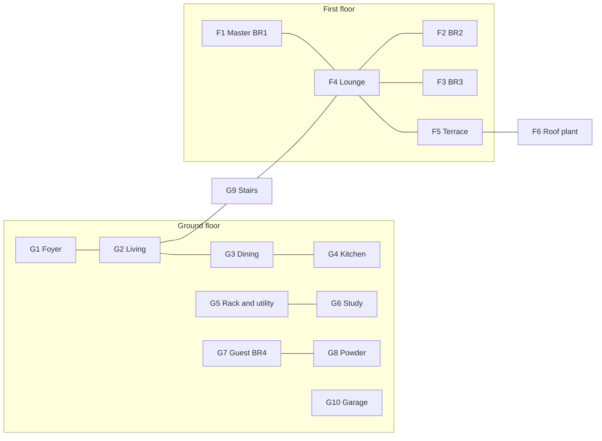

# 01. System Overview and Design Principles

## 1.1 Purpose

This pack defines the smart home system for a sample 4-bedroom wellness villa. It is written the way a Smart Home Project Manager hands work to architects, MEP consultants and integrators: decisions first, then the reasons, then the checklists needed to build it.

The brief is a home that feels calm and healthy. Technology should be invisible, reduce unnecessary radio exposure, keep working when the internet does not, and be maintainable by someone other than the original installer.

> **Scope note.** This is a design exercise on an assumed building. It is not a certified construction document. Final drawings, load calculations and code compliance (for example IS 732 / NBC in India, NEC in the US) must be confirmed by licensed local professionals. "Low-EMF" here means *design choices that reduce unnecessary radio-frequency sources near where people sleep and rest*. It is not a medical or health claim.

## 1.2 Assumed building

| Item | Assumption |
|---|---|
| Type | Detached two-storey villa (G+1) with accessible terrace |
| Plot / built-up | About 40 x 60 ft plot, about 3,400 sq ft (about 316 m2) built-up |
| Structure | RCC frame, brick/AAC infill, plastered; false ceilings in living areas |
| Climate | Warm, humid or composite (India-style); mechanical cooling and fresh-air ventilation both needed |
| Supply | 3-phase mains, rooftop solar-ready, one EV charger bay |
| Water | Municipal + borewell inlet, RO and filtered drinking water, overhead tank |
| Occupants | Family of 4 to 6, one older adult possible (accessibility and night lighting matter) |

### Assumed floor plan

**Ground floor (about 1,800 sq ft)**

| ID | Room | Notes |
|---|---|---|
| G1 | Foyer and porch | Main entry, video doorbell, smart lock |
| G2 | Living room | Double-height edge, large glazing |
| G3 | Dining | Open to living |
| G4 | Kitchen | Gas hob, chimney, RO point |
| G5 | Utility and rack room | Under-stair core, about 2.0 x 2.2 m, ventilated, lockable. Main water entry here |
| G6 | Study / home office | Wired desk, needs good air quality |
| G7 | Guest bedroom (BR4) with bath | Ground floor for older relatives |
| G8 | Powder room | |
| G9 | Staircase | Night path lighting |
| G10 | Garage and driveway | One car, EV charger |

**First floor (about 1,600 sq ft)**

| ID | Room | Notes |
|---|---|---|
| F1 | Master bedroom (BR1) with dressing and bath | Strictest low-EMF zone |
| F2 | Bedroom 2 (BR2) | Child or teen |
| F3 | Bedroom 3 (BR3) with bath | |
| F4 | Family lounge | Landing space, Wi-Fi AP location |
| F5 | Balcony / terrace | Outdoor air station, camera |
| F6 | Roof | Solar, overhead tank, HVAC outdoor units |

The diagram is schematic adjacency, not a drawing.

## 1.3 Design principles

### 1. Wellness first

Every device must earn its place by improving sleep, air, water, light or safety. Features that only add novelty are left out.

- **Light follows the day.** Warm and dim in the evening, bright and cool-white in the morning and daytime, near-dark amber for night trips. Details in [03](03-subsystems.md).
- **Air is measured, not guessed.** CO2, PM2.5, VOC, temperature and humidity are measured in occupied rooms, and ventilation responds to them.
- **Water is monitored at the point of use.** TDS and leak detection, with an automatic shut-off.
- **Quiet and calm.** No beeps, no unexpected speech, no glowing status LEDs in bedrooms. Equipment with fans lives in the rack room, not in bedrooms.

### 2. Wired first, low-EMF by design

- Anything that can sit on a cable does: lighting control, switches, sensors, access points, cameras, doorbell, thermostats.
- Wireless is allowed only when a cable is impractical (battery leak sensors, door lock, a few retrofittable sensors), and then on low-duty protocols (Zigbee, Thread) rather than constantly transmitting Wi-Fi.
- Bedroom rule: no Wi-Fi access point inside bedrooms. APs sit in the lounge and living areas, and the radios that cover bedrooms are scheduled off at night. Every bedroom has wired Ethernet outlets so devices can be used with Wi-Fi turned off.
- Cabling hygiene: separate power and low-voltage runs, shielded Cat6A, and the bed-head wall kept clear of mains-heavy equipment where the architect can arrange it.

### 3. Local control that works without the cloud

- The house must keep its core functions with the internet cable unplugged: lights, shading, climate, ventilation, leak shut-off, locks, alarm and recording.
- Home Assistant runs on a local server as the integration hub. Cloud services are optional extras (remote access, notifications) and never a dependency for a light switch.
- Safety logic that must not fail (leak shut-off, smoke and gas actions, ventilation on high CO2) runs on dedicated bus devices or hub automations with a defined fallback, not in a cloud service.
- Every wall switch works as a normal switch if the hub is down.

### 4. Open standards

- Preference order: **KNX / DALI-2 / Modbus / Ethernet (IEEE 802.3)** for wired, **Zigbee 3.0 / Thread / Matter** for wireless, **MQTT / REST** for integration.
- Any component should be replaceable by another vendor speaking the same standard. No single vendor can hold the house hostage.
- Configuration is documented and exportable: KNX ETS project file, Home Assistant configuration in version control, network and VLAN plan on paper.

### 5. Serviceable and honest about cost

- A competent local electrician plus one trained integrator can maintain the system. Parts are standard and stocked in India and the US.
- Prices in this pack are rough estimates for planning, not quotes ([06](06-bill-of-materials.md)).

## 1.4 System layers

| Layer | What lives here | Standard |
|---|---|---|
| Field devices | Keypads, presence and lux sensors, air nodes, valves, meters, contacts | KNX TP, Zigbee, Thread, Modbus RTU |
| Control bus | Lighting, shading, HVAC interface | KNX TP, DALI-2 (via gateways) |
| Network | Cabling, switches, APs, VLANs, firewall | Ethernet, PoE+, Wi-Fi 6 |
| Integration | Automations, dashboards, history, alerts | Home Assistant, MQTT |
| Resident interface | Wall keypads first, tablet/phone second, voice optional and local | KNX, HA app, Matter |

## 1.5 Document map

| Doc | Content |
|---|---|
| [02](02-protocols-and-platforms.md) | Protocol choices and platform comparison |
| [03](03-subsystems.md) | Subsystem designs |
| [04](04-topology.md) | Topology diagrams |
| [05](05-device-schedule.md) | Room-by-room device schedule |
| [06](06-bill-of-materials.md) | Bill of materials and budget |
| [07](07-design-coordination-checklist.md) | Architect and MEP checklist |
| [08](08-commissioning-checklist.md) | Commissioning and testing |
| [09](09-resident-quick-guide.md) | Resident guide |
| [10](10-facility-runbook.md) | Facility-management runbook |
| [11](11-project-timeline.md) | Timeline by construction stage |
