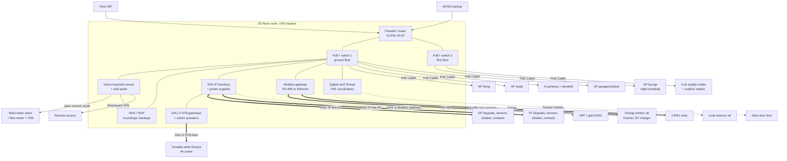
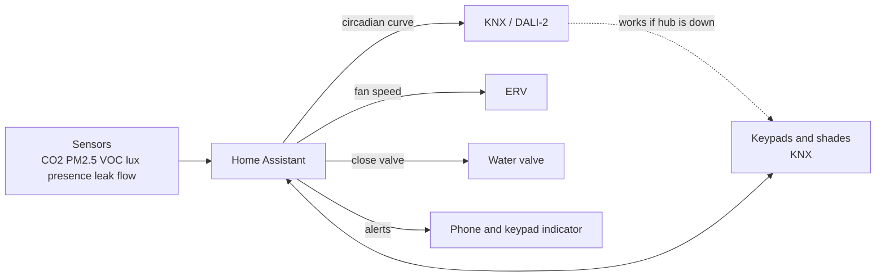

# 04. Topology

## 4.1 System topology

Line styles: thick = wired control bus, thin = Ethernet/PoE, dotted = wireless or vendor gateway.

## 4.2 Data and control flow

If Home Assistant is offline: keypads, scenes, shading, local thermostats and the leak valve interlock still work. Circadian curves fall back to the KNX scheduler, and the ERV runs on a schedule.

## 4.3 Zoning summary

| Zone | KNX line | DALI line | PoE switch | VLAN highlights |
|---|---|---|---|---|
| Ground floor | Line 1 | DALI 1 and 2 | SW1 | 30, 40, 60 |
| First floor | Line 2 | DALI 3 | SW2 | 30, 60 |
| Exterior / garage | Line 1 (outdoor branch) | DALI 1 | SW1 | 40 |
| Roof / plant | Via Modbus and Ethernet | None | SW2 | 60 |

Two KNX lines keep each line's load under the 64-device limit with headroom for expansion, and let a fault on one floor be isolated.
